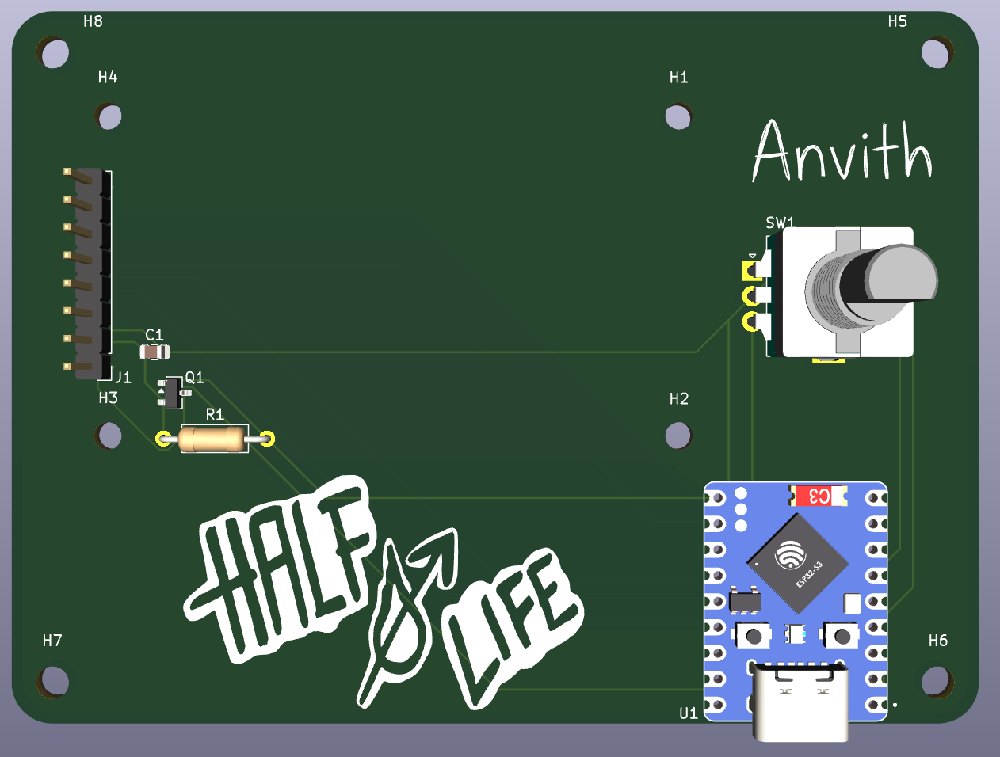
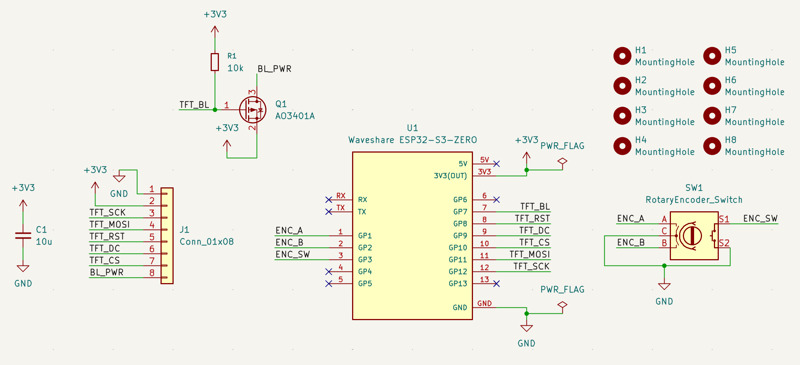
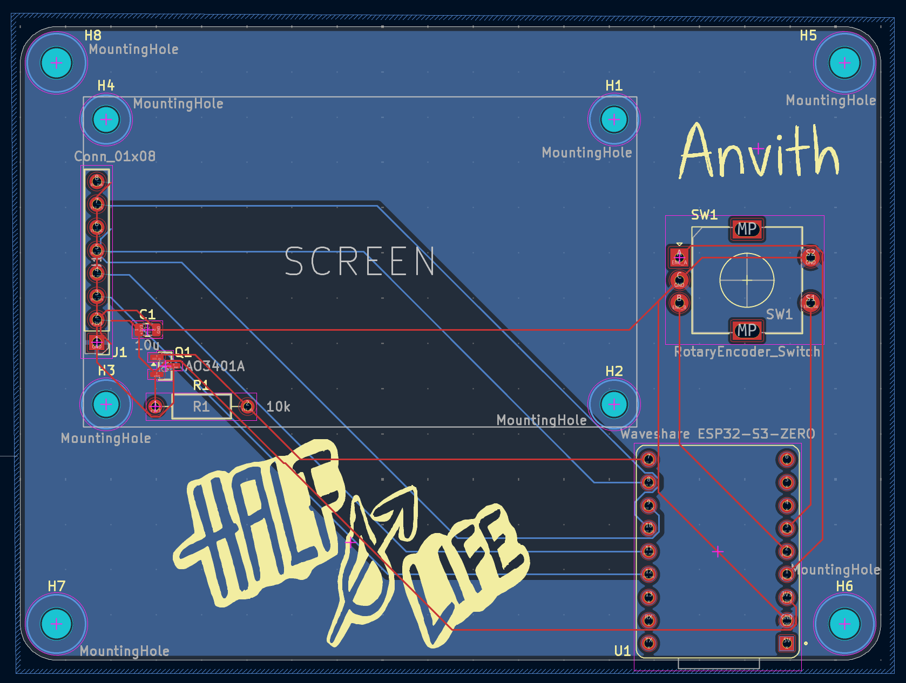
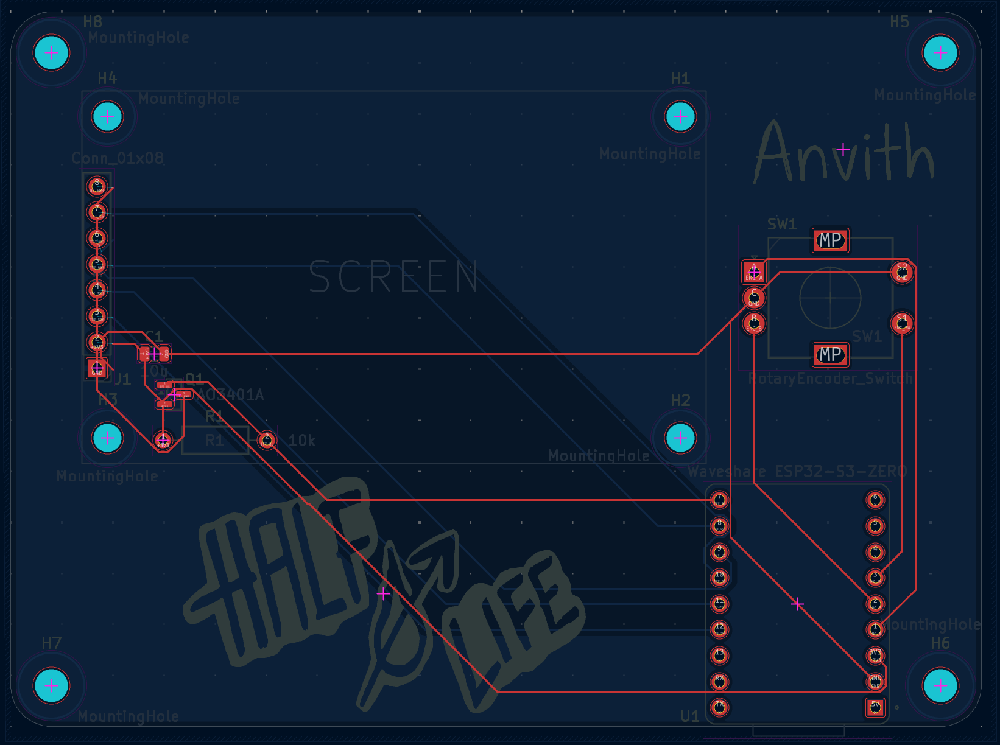
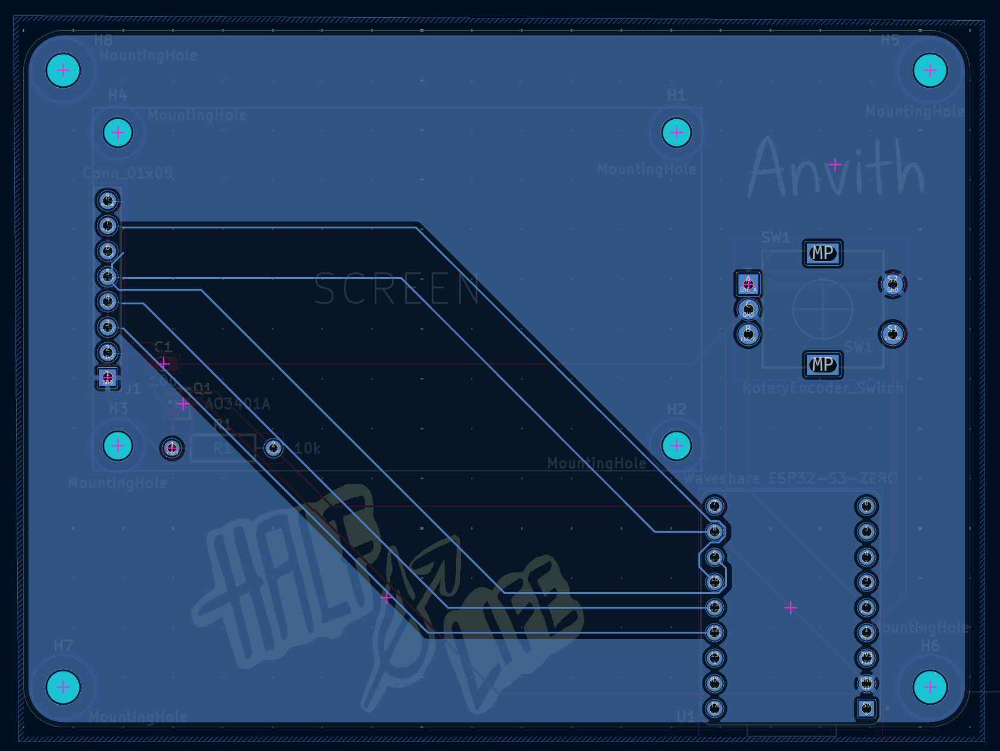

# HalfLifeWeek4-Displays
For Week 4 I designed my own project from scratch: a Wi-Fi desk dashboard. It's a small PCB with an ESP32-S3-Zero, a 2.0" color screen, and one rotary encoder. It sits on my desk and shows the things I check every day, so I don't have to pick up my phone for them. Turning the knob switches between 9 pages, and pressing it does something different on each page.
 
**3D Model / Final PCB Render:**

 
**Schematic:**

 
**Board Layout & Routing:**
 
Combined Layout:

 
Front Copper Layer:

 
Back Copper Layer:

 
**What it is and how it works:**
 
The dashboard has 9 pages:

- Clock
- Weather
- Pomodoro timer
- Daily chess puzzle from lichess
- My lichess and chess.com ratings
- My FRC team's (team 2220) next event and how many days until it starts
- GitHub stuff
- Quote/fun fact
- Countdowns (days until dates I care about)
 
These are the parts:
 
* **Waveshare ESP32-S3-Zero:** This is kind of like the brain of the board. It also connects to Wi-Fi, downloads data from APIs, and draws everything on the screen.
* **Screen:** This uses SPI to "talk" to the ESP32. It plugs into the PCB.
* **AO3401A and resistor:** This switches the screen's backlight. The ESP32 sends a PWM signal to it, which lets the firmware dim the screen for night mode. The resistor keeps the backlight off while the ESP32 is starting up.
* **Encoder:** Turning it changes the page, and if you do a short press it does an action (depending on the page). If you do a long press, it will either reset the timer or toggle night mode.
* **Capacitor:** This is placed next to the screen connector to smooth out the screen's power.
* **The ESP32-S3-Zero's built in LED:** This changes color to match the current page, and turns red/green when the Pomodoro timer is running.
 
**Why I made it:**
 
In Weeks 1 to 3 I followed guides and then changed them. However, for this week, I wanted to design the whole thing myself. I also wanted something I would actually use every day. Since I play chess a lot, I'm on an FRC team, and I use Pomodoro timers to study, I decided to put all of those on one screen, since this week is about displays. I also learned a lot from making this, especially on the software side (since most of the hardware stuff was similar to Weeks 1 and 3).
 
**How to assemble and flash the firmware:**
 
**1. How to assemble the board**
 
You need a soldering iron, solder, flux, tweezers, flush cutters, and a multimeter. You also want to solder from the flattest part to the tallest part:
 
1. **Q1 (AO3401A MOSFET):** Put a little solder on one pad, hold the part with tweezers, and melt that pad to tack it down. Check that all 3 legs line up, then solder the other 2.
2. **C1 (10uF capacitor):** Do the same thing that you did for Q1: tack one end, then solder the other.
3. **U1 (ESP32-S3-Zero):** Line it up with the outline, with the USB-C port over the board edge. Tack one corner, then solder every edge pad and check for bridges.
4. **R1 (10k resistor):** Bend the legs, push it through, solder and trim.
5. **SW1 (EC11 encoder):** Snap it in, then solder the 5 pins and the 2 big mounting tabs.
6. **J1 (screen):** Push the screen's header pins through the 8 holes, with GND in the square pad. Screw the screen to the 4 mounting holes with M2 screws (optional), then solder the pins.

Before plugging in, use the multimeter in continuity mode to check that 3V3 and GND are not shorted.
 
**2. How to flash the firmware**
 
1. Install the Arduino IDE.
2. In the Boards Manager, install esp32 by Espressif Systems and select ESP32S3 Dev Modules as the board.
3. Under the Tools menu, set USB CDC On Boot to Enabled so the Serial Monitor works over USB-C.
4. Install these libraries in the Library Manager:
   * Adafruit ST7735 and ST7789 Library
   * Adafruit GFX
   * ArduinoJson
   * Adafruit NeoPixel
5. Copy DeskDashboard/secrets_example.h to DeskDashboard/secrets.h and fill in your Wi-Fi name, Wi-Fi password, and (optionally) a free read API key from The Blue Alliance.
6. At the top of DeskDashboard.ino, change the usernames, location, and countdown dates to your own.
7. Open DeskDashboard/DeskDashboard.ino, plug the board in with a USB-C data cable, and click Upload. If it doesn't upload, hold the BOOT button on the ESP32-S3-Zero, tap RESET, release BOOT, and try again.
The screen should show "Connecting to Wi-Fi...". Turn the knob to check that the pages and LED color change.
 
**BOM:**
 
The full bill of materials is in [BOM.csv](BOM.csv):
 
| Item | Qty | Supplier | Cost/item | Total cost | Link |
| --- | ---: | --- | ---: | ---: | --- |
| ESP32-S3-Zero (no headers) | 1 | AliExpress | $4.32 | $4.32 | [AliExpress](https://www.aliexpress.us/item/3256807949476561.html) |
| 2.0" IPS ST7789 screen (8-pin) | 1 | AliExpress | $6.18 | $6.18 | [AliExpress](https://www.aliexpress.us/item/3256804844327418.html) |
| AO3401A MOSFET (100-pack) | 1 | AliExpress | $1.84 | $1.84 | [AliExpress](https://www.aliexpress.us/item/2251801213228611.html) |
| 10uF 0805 capacitor (200-pack) | 1 | AliExpress | $2.26 | $2.26 | [AliExpress](https://www.aliexpress.us/item/2251800929439420.html) |
| EC11 rotary encoder (spare from Week 3) | 1 | AliExpress | $0.00 | $0.00 | [AliExpress](https://www.aliexpress.us/item/3256808530463909.html) |
| 10k resistor (100-pack) | 1 | AliExpress | $1.27 | $1.27 | [AliExpress](https://www.aliexpress.us/item/3256806338200607.html) |
| PCB (2-layer, 95x70mm) | 1 | JLCPCB | $4.00 | $4.00 | [JLCPCB](https://jlcpcb.com/) |
| Shipping (AliExpress Choice) | — | AliExpress | — | $0.00 | — |
| Shipping (JLCPCB Global Standard Direct Line) | — | JLCPCB | — | $8.16 | — |
| Estimated sales tax (8.125% on AliExpress parts) | — | — | — | $1.29 | — |
| **Estimated total** |  |  |  | **$29.32** |  |